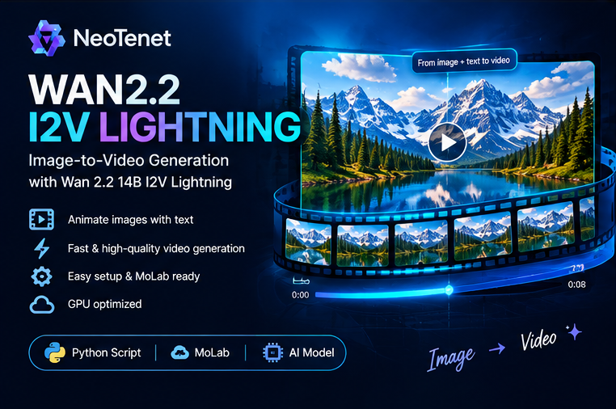
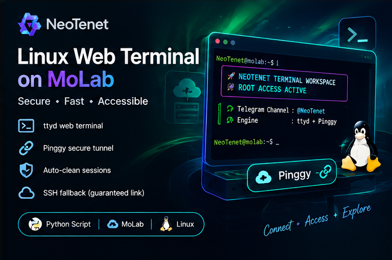

# 💎 NeoTenet AI Model Collection

**A growing collection of Python scripts for running AI projects and useful Linux tools in MoLab and compatible environments.**

**Created and maintained by [NeoTenet](https://github.com/NeoTenet)** · [Telegram Channel](https://t.me/NeoTenet)

---

## 🇮🇷 درباره پروژه

این مخزن مجموعه‌ای در حال توسعه از اسکریپت‌های پایتونی برای راه‌اندازی و آزمایش پروژه‌های هوش مصنوعی و ابزارهای کاربردی لینوکس است. هدف، قرار دادن ابزارها در یک محل منظم، توضیح کاربرد هرکدام و ساده‌تر کردن شروع کار در MoLab یا محیط‌های سازگار با Python است.

مجموعه به‌مرور به‌روزرسانی می‌شود؛ ممکن است نسخه‌های جدید، ابزارهای متفاوت یا اصلاحات مربوط به اجرای مدل‌ها به آن اضافه شوند. برای اطلاع از تغییرات، تاریخچهٔ مخزن را بررسی کنید.

## 🧠 فایل‌های موجود

| فایل پایتون | کاربرد و توضیحات |
|---|---|
| [`Qwen Image 2.1 Turbo-Molab.py`](https://github.com/NeoTenet/Neo_Molab_Ai_Model/blob/main/Qwen%20Image%202.1%20Turbo-Molab.py) | **Qwen Image 2.1** — اسکریپت راه‌اندازی رابط Gradio برای نسخه Turbo از خانواده Qwen Image. این مدل برای تولید تصویر از دستور متنی و ویرایش تصویر بر اساس تصویر ورودی و توضیحات متنی کاربرد دارد. [مرجع پروژه](https://huggingface.co/spaces/hugging-apps/qwen-qwen-image-2-1-turbo). اسکریپت مخزن مربوط به پروژه را دریافت می‌کند، وابستگی‌ها را آماده می‌سازد، تنظیمات حافظه را اعمال می‌کند و تلاش می‌کند رابط را با یک لینک عمومی در دسترس قرار دهد. |
| [`Qwen Image V2 30B-Molab.py`](https://github.com/NeoTenet/Neo_Molab_Ai_Model/blob/main/Qwen%20Image%20V2%2030B-Molab.py) | **Qwen Image 2** — برای گردش‌کارهای ویرایش تصویر در نظر گرفته شده است؛ از کاربردهای این خانواده می‌توان به تغییر بخش‌هایی از تصویر ورودی، اصلاح جزئیات و تولید نتیجهٔ ویرایش‌شده بر اساس دستور متنی اشاره کرد. امکانات دقیق به نسخه و رابط اجرایی بستگی دارد. |
| [`WAN2.2 I2V LIGHTNING-Molab.py`](https://github.com/NeoTenet/Neo_Molab_Ai_Model/blob/main/WAN2.2%20I2V%20LIGHTNING-Molab.py) | **Wan 2.2 14B I2V Lightning** — اسکریپت راه‌اندازی [محیط Rchoks/wan555](https://huggingface.co/spaces/Rchoks/wan555) برای ساخت ویدئو از یک تصویر ورودی. تصویر، همراه با توضیح متنیِ حرکت یا صحنه، مبنای متحرک‌سازی قرار می‌گیرد؛ بسته به رابط بالادستی، امکان استفاده از فریم پایانی و تنظیمات تولید نیز وجود دارد. اجرای آن به GPU و منابع کافی وابسته است. |
| [`Drbian_Root_Terminal_Molab.py`](https://github.com/NeoTenet/Neo_Molab_Ai_Model/blob/main/Drbian_Root_Terminal_Molab.py) | **NeoTenet Linux Web Terminal** — راه‌اندازی یک ترمینال تعاملی لینوکس در مرورگر MoLab با استفاده از `ttyd` روی پورت `7681` و ایجاد لینک عمومی از طریق Pinggy. اسکریپت ابزارهایی مانند `htop`، `curl`، `wget`، `git` و `python3-pip` را نصب می‌کند، بستهٔ Python مربوط به Pinggy را آماده می‌سازد و در صورت نیاز فایل اجرایی `ttyd` نسخهٔ 1.7.7 برای معماری x86_64 را دریافت می‌کند. برای ساخت لینک ابتدا از کتابخانهٔ Pinggy و در صورت نیاز از اتصال SSH به‌عنوان روش جایگزین استفاده می‌کند. این ابزار یک ترمینال لینوکس است، نه مدل هوش مصنوعی، و ذاتاً به GPU نیاز ندارد. |

## 🖼️ بنرهای پروژه‌ها

### Qwen Image 2.1 Turbo

### Qwen Image V2 30B

### WAN2.2 I2V Lightning

### NeoTenet Linux Web Terminal on MoLab

### انتخاب سریع

- برای تولید و ویرایش تصویر با نسخه Turbo، فایل Qwen Image 2.1 را انتخاب کنید.
- برای گردش‌کار Qwen Image 2 و ویرایش تصویر بر اساس دستور متنی، فایل دوم مجموعه را انتخاب کنید.
- برای متحرک‌سازی تصویر و تولید ویدئو از تصویر و توضیح متنی، از اسکریپت Wan 2.2 I2V Lightning استفاده کنید.
- برای دسترسی به خط فرمان لینوکس از طریق مرورگر و مدیریت محیط MoLab، اسکریپت NeoTenet Linux Web Terminal را اجرا کنید.

## 🚀 راه‌اندازی در MoLab

1. وارد [MoLab](https://molab.marimo.io/notebooks) شوید و یک محیط Python مناسب ایجاد کنید.
2. در صورت امکان، فایل پایتون موردنظر را در محیط باز یا وارد کنید. اگر محیط شما اجرای مستقیم فایل را پشتیبانی نمی‌کند، محتوای فایل را در سلول Python قرار دهید و اجرا کنید.
3. برای اسکریپت‌هایی که به شتاب‌دهنده نیاز دارند، از فعال بودن GPU مطمئن شوید.
4. اجرای اسکریپت را شروع کنید و خروجی را بررسی کنید. اسکریپت‌ها ممکن است مخزن بالادستی را دریافت، وابستگی‌ها را نصب و فایل‌های مدل را دانلود کنند؛ مرحلهٔ آماده‌سازی می‌تواند زمان‌بر باشد.
5. اگر راه‌اندازی رابط وب موفق باشد، آدرس آن در خروجی یا لاگ‌ها نمایش داده می‌شود. تا پایان استفاده، فرایند اجرا را متوقف نکنید.
6. برای پایان کار، اجرای سلول یا فرایند Python را متوقف کنید.

**برای ترمینال لینوکس:** فایل `Drbian_Root_Terminal_Molab.py` را اجرا کنید؛ پس از آماده‌سازی `ttyd` و تونل Pinggy، لینک دسترسی در خروجی نمایش داده می‌شود. برای بستن ترمینال، اجرای سلول یا فرایند Python را متوقف کنید. این اسکریپت برای نصب بسته‌های سیستمی و نوشتن در مسیرهای سیستمی به دسترسی کافی نیاز دارد؛ دسترسی Root فقط زمانی فراهم است که خود محیط MoLab فرایند را با همان سطح دسترسی اجرا کرده باشد.

> رابط MoLab، محدودیت‌های زمان اجرا و نوع GPU در دسترس ممکن است تغییر کنند؛ مراحل بالا به امکانات محیطی که انتخاب می‌کنید بستگی دارند.

## 💻 پیش‌نیازها

- محیط Python سازگار با اسکریپت و امکان اجرای فرمان‌های خط فرمان؛
- GPU انویدیا و نسخه‌های سازگار PyTorch/CUDA برای اسکریپت‌هایی که GPU را الزامی می‌دانند؛ ترمینال لینوکس به‌خودی‌خود به GPU نیاز ندارد؛
- اینترنت پایدار و فضای دیسک کافی برای دریافت مخازن، وابستگی‌ها و وزن‌های مدل؛
- حافظهٔ GPU و RAM متناسب با مدل انتخابی؛
- اجازهٔ نصب بسته‌های Python و اجرای سرویس یا تونل عمومی در محیط مورد استفاده؛ برای اسکریپت ترمینال، دسترسی کافی برای اجرای `apt-get` و نصب فایل در `/usr/local/bin` نیز لازم است.

**توجه:** داشتن فایل اسکریپت به‌تنهایی به معنی تضمین اجرای موفق مدل نیست. سازگاری کتابخانه‌ها، میزان حافظه، محدودیت‌های محیط میزبانی و تغییرات مخزن بالادستی همگی مؤثرند.

## 🧰 عیب‌یابی

| مشکل | کار پیشنهادی |
|---|---|
| GPU شناسایی نمی‌شود | نوع سخت‌افزار را روی GPU قرار دهید و سازگاری PyTorch و CUDA را بررسی کنید. |
| نصب کتابخانه‌ها شکست می‌خورد | خطای کامل نصب، نسخه Python و وابستگی‌های پروژه بالادستی را بررسی کنید. |
| دانلود مدل طول می‌کشد یا متوقف می‌شود | اتصال اینترنت، فضای آزاد و محدودیت‌های محیط اجرا را بررسی کنید. |
| لینک عمومی نمایش داده نمی‌شود | لاگ‌های انتهایی را بررسی کنید؛ لینک فقط در صورت بالا آمدن سرویس و موفقیت تونل ایجاد می‌شود. |
| ترمینال لینوکس اجرا نمی‌شود یا نصب بسته‌ها خطا می‌دهد | دسترسی کاربر به `apt-get` و `/usr/local/bin`، اتصال اینترنت و سازگاری معماری x86_64 برای فایل `ttyd` را بررسی کنید. |
| پورت ترمینال اشغال است | اجرای قبلی `ttyd` را متوقف کنید و سپس اسکریپت را دوباره اجرا کنید. |
| خطای کمبود حافظه رخ می‌دهد | GPU دیگری با حافظه بیشتر انتخاب کنید یا محدودیت‌های حافظه و تنظیمات مدل را بررسی کنید. |

## 🔐 امنیت و مجوزها

- پیش از اجرا، کد را مرور کنید؛ اسکریپت‌ها ممکن است فرمان‌های shell اجرا کنند، مخازن خارجی را دریافت کنند یا وابستگی‌های جدید نصب کنند.
- اگر رابط وب از طریق لینک عمومی منتشر شد، اطلاعات خصوصی یا محرمانه در آن وارد نکنید و لینک را با احتیاط به اشتراک بگذارید.
- **هشدار ویژهٔ ترمینال:** اسکریپت `Drbian_Root_Terminal_Molab.py`، `ttyd` را با گزینهٔ `-W` اجرا می‌کند؛ بنابراین دارندهٔ لینک عمومی می‌تواند در ترمینال فرمان وارد کند. در فرمان اجرای `ttyd` احراز هویت یا رمز عبوری تنظیم نشده است. لینک را عمومی نکنید، فقط در زمان نیاز اجرا کنید و پس از پایان کار فرایند را متوقف کنید. فرمان‌ها با سطح دسترسی همان کاربری اجرا می‌شوند که اسکریپت را اجرا کرده است؛ نمایش عبارت Root در سربرگ به‌تنهایی تضمین‌کنندهٔ دسترسی Root نیست.
- مجوز استفاده از هر مدل، مخزن بالادستی و وابستگی ثالث را جداگانه بررسی کنید. مجوز این مخزن لزوماً جایگزین مجوز پروژه‌های اصلی نیست.
- می‌توانید این مخزن را Fork کنید، کپی بگیرید و برای استفاده شخصی تغییر دهید؛ هنگام انتشار دوباره، شرایط مجوزهای مربوط را رعایت کنید.

## 🔄 به‌روزرسانی‌ها

این مجموعه توسط NeoTenet به‌مرور توسعه می‌یابد. تغییرات بعدی می‌تواند شامل اضافه‌شدن پروژه‌های جدید، بهبود راهنمای اجرا، اصلاح سازگاری و به‌روزرسانی پیوندهای مرجع باشد. برای دیدن نسخهٔ تازه، تاریخچهٔ Commitها را بررسی کنید یا مخزن را Watch کنید.

## 👤 سازنده و ارتباط

**ساخته و نگه‌داری‌شده توسط NeoTenet**  
تلگرام: [t.me/NeoTenet](https://t.me/NeoTenet)  
مخزن: [NeoTenet/Neo_Molab_Ai_Model](https://github.com/NeoTenet/Neo_Molab_Ai_Model)

---

## 🇬🇧 About the Project

NeoTenet AI Model Collection is an evolving set of Python scripts for exploring AI projects and useful Linux tools in MoLab and compatible Python environments. The repository aims to keep the scripts organized, explain their practical uses, and make it easier to get started. New projects, compatibility fixes, and documentation updates may be added over time.

### Included scripts

- **Qwen Image 2.1 Turbo-Molab.py** — launches a Gradio-based Qwen Image 2.1 Turbo workflow. The Qwen Image family is designed for prompt-based image generation and image editing guided by an input image and text instructions. [Project reference](https://huggingface.co/spaces/hugging-apps/qwen-qwen-image-2-1-turbo). The script prepares dependencies and attempts to expose the web interface through a public link.
- **Qwen Image V2 30B-Molab.py — Qwen Image 2** — listed in this collection as Qwen Image 2 for image-editing workflows. Typical uses include changing parts of an input image, refining visual details, and generating an edited result guided by text instructions. Available features depend on the model version and interface.
- **WAN2.2 I2V LIGHTNING-Molab.py** — launches the [Rchoks/wan555](https://huggingface.co/spaces/Rchoks/wan555) Wan 2.2 14B Image-to-Video workflow. It animates an input image using a text prompt, subject to the upstream interface and available hardware.
- **[Drbian_Root_Terminal_Molab.py](https://github.com/NeoTenet/Neo_Molab_Ai_Model/blob/main/Drbian_Root_Terminal_Molab.py)** — starts an interactive Linux terminal in the browser using `ttyd` on port `7681` and a public Pinggy tunnel. It installs utilities such as `htop`, `curl`, `wget`, `git` and `python3-pip`, installs the Pinggy Python package, and downloads the `ttyd` 1.7.7 x86_64 binary when it is not already present. It first attempts to create the tunnel with the Pinggy Python library and falls back to SSH if needed. This is a Linux terminal utility, not an AI model, and it does not inherently require a GPU.

### Project banners

The four project banner images are stored directly in the repository root beside this README, and are embedded with relative paths so GitHub renders them directly.

### Quick start

1. Open [MoLab](https://molab.marimo.io/notebooks) and create a compatible Python environment.
2. Open/import the desired Python script, or place its contents into a Python cell if direct script execution is unavailable.
3. Enable a compatible GPU when required, then run the script.
4. Follow the logs while dependencies and model files are prepared. If the web service starts successfully, its public URL should appear in the output.
5. Stop the running cell or Python process when finished.

For the Linux terminal, run `Drbian_Root_Terminal_Molab.py`. Once `ttyd` and the Pinggy tunnel are ready, the access URL is printed in the output. Stop the Python process when you finish. The script needs sufficient permissions to run `apt-get` and write to system locations; Root access depends on the permissions of the MoLab process and is not guaranteed by the script banner.

### Requirements and notes

A compatible Python environment, internet access, sufficient disk space and RAM are required. A suitable NVIDIA GPU may be needed by some model scripts, but the Linux web terminal does not inherently require one. The terminal script also needs permission to use `apt-get` and write to `/usr/local/bin`, plus an x86_64 environment for the downloaded `ttyd` binary. Model downloads and dependency installation can take time. Successful execution depends on the runtime, library versions, GPU memory and the current state of the upstream projects; it is not guaranteed in every hosted environment.

Review scripts before running them because they may execute shell commands, download code or binaries, install packages and expose a web interface through a public link. **Special warning for `Drbian_Root_Terminal_Molab.py`:** it starts `ttyd` with the `-W` option, which allows visitors to type commands in the terminal. The current `ttyd` command does not configure password authentication. Treat the Pinggy URL as sensitive: do not share it publicly, run the terminal only when needed, and stop the process when finished. Commands run with the permissions of the user running the script; the banner text alone does not guarantee Root access. Check the license of each upstream project and model before redistributing or using it commercially. Forking and personal customization are welcome, subject to the applicable upstream terms.

**Maintainer:** [NeoTenet](https://github.com/NeoTenet) · **Telegram:** [t.me/NeoTenet](https://t.me/NeoTenet)

---

**NeoTenet — AI Tools, Models & Updates 💎**

